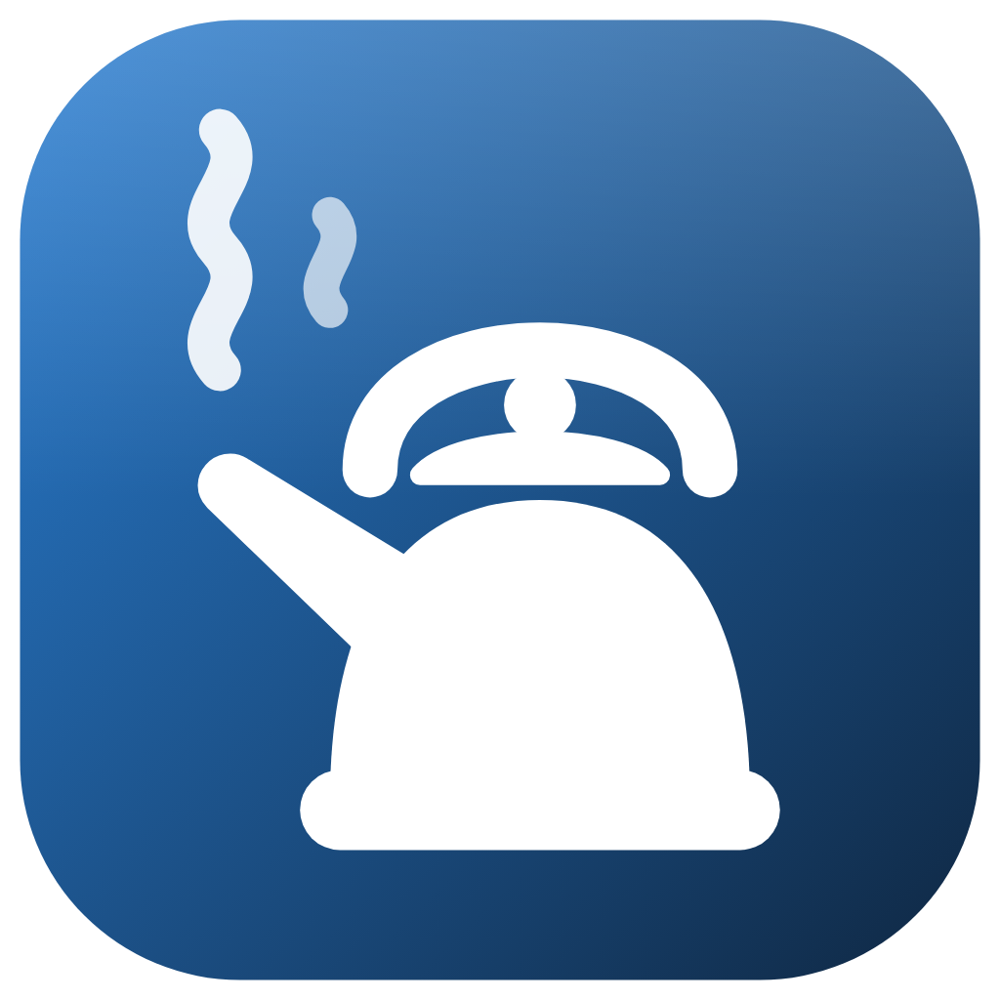

<p align="center"></p>

<h1 align="center">Steam Master Idler</h1>

<p align="center">Idle your Steam games until they hit the hours you want, and farm trading-card drops,<br>without running the games or even the Steam client.</p>

---

## Features

- **Hours idler:** idle a game **forever**, **until its total reaches X hours**, **for another X hours**, or **until its card drops run out**.
- **Card idler:** one click farms every game that still has trading-card drops, using the idling behavior and order you choose. Each game stops when its drops are gone. It also runs **alongside** hours idling: while idling, tap **+ Card games** (or start the card idler) and the card games join the running session.
- **QR-code login:** scan with the Steam mobile app; no password typed. Username, password and Steam Guard also work. You only log in once.
- **All-time stats:** total time idled, game-hours added, card drops collected and sessions, plus your most-idled games and your whole library's playtime. Kept across restarts and updates.
- **Up to 32 games at once.** Extra games wait in a queue and start as others finish.
- **Session limit:** stop everything after X hours.
- **Runs in the tray:** closing the window keeps it idling. Desktop notifications tell you when targets are reached.
- **Play while idling:** on Windows it idles through your Steam app, so you can keep playing other games.
- Optional "start when I log in", custom status text and online/invisible status.
- **Tools tab** with extra Steam features that use the same sign-in. Each one has its own on/off switch, and a tool that's off isn't loaded at all:
  - **📷 Screenshot uploader:** screenshots you take in games (F12) are uploaded to your Steam screenshot library by themselves once you close the game, **private** by default.
  - **🏆 Achievement manager:** see, unlock and lock any game's achievements, like Steam Achievement Manager, at once or one every N minutes. No game install needed.
  - **🏷 Wishlist sale alerts:** a notification when a wishlist game is discounted enough, or drops to your price.
  - **🎁 Sale event helper:** claims the free daily sale sticker and goes through your Discovery Queue during Steam sales, once a day.
  - **🆓 Free game claimer:** paste store links or AppIDs of free games and they're added to your account.
- **Light on resources:** the window is closed completely while the app sits in the tray (Settings → *Free memory while in the tray*), and the page stops refreshing while it's hidden.

## Settings

Click **⚙ Settings** in the top bar.

**Idling method**
- **Through the Steam app on this PC** (Windows, the default there): the games show as running in your own Steam app, the way Idle Master does it, so **you can launch and play other games normally while idling**. The Steam app must be running and logged in to the same account. It uses `steamclient64.dll` from your own Steam install; no Valve files are bundled.
- **With the idler's own Steam login**: works without the Steam app (any OS, or a PC without Steam). Steam only lets one session play at a time, so starting a game in Steam disconnects the idler until you close that game, then it resumes.

The idler never changes your online status unless you pick one under **Show me as** (default: keep my Steam app's status).

| General | |
|---|---|
| Minimize to system tray | Minimizing or closing keeps idling in the tray. Off: closing quits. |
| Free memory while in the tray | Closes the window completely while it's in the tray (about 100 MB less); opening it again takes a second. On by default. |
| Dark theme | Switch between dark and light. |
| Show Steam username | Show your name in the top bar. |
| Prevent computer from sleeping | Keeps the computer awake while idling. |
| Shut down computer when done | Powers off when everything is finished, after a 60-second countdown you can cancel. |
| Idle only games I've played before | Skips games you haven't played yet, so new games stay refundable (Steam refunds games played under 2 hours). "Played" means at least N minutes, 1 by default. |
| Keep me signed in on this device | Saves your Steam sign-in (never your password). If Steam disconnects, the idler reconnects by itself and resumes. Off: sign in each time the app starts. |
| Take over idling when my other device stops | When your PC (or another device) stops playing/idling, this device starts idling its queue (or the card idler) a minute later, and pauses again if the other one starts. Not used when idling through the Steam app. |

**Card idling behavior**
- **Fast mode** (recommended): all card games together for 5 minutes, then each one alone for a moment to trigger drops, then repeat.
- **All games at once:** every card game together the whole time.
- **Idle each game individually:** one at a time until its drops run out.
- **Simultaneously up to 2 hours, then individually.**
- **More than 2 hours individually, then simultaneously.**

**Card idling order:** alphabetical, most drops first, or fewest drops first.

No game is actually launched, so there is no VAC risk.

## Tools

Switch between **🎮 Idler** and **🧰 Tools** at the top of the window. Tools share the idler's Steam sign-in and keep running in the tray. Every tool is **off** until you switch it on in its header. A tool that's off isn't loaded and runs no timers or requests.

### 📷 Screenshot uploader (desktop app)

1. Open **🧰 Tools** and switch **Screenshot uploader** on.
2. Play and take screenshots with Steam (F12) as usual.
3. Close the game. The new screenshots are uploaded to your Steam screenshot library and you get a notification.

| Option | |
|---|---|
| When to upload | **After I close the game** (default), or **Right after each screenshot**. |
| Visibility on Steam | **Private** (default), Friends only, Unlisted or Public. |
| Steam folder | Found automatically. Set it only if Steam is installed somewhere unusual. |

- Only screenshots taken **after** you switch it on are uploaded automatically. **Upload N older screenshots** uploads the ones from before. Any that Steam's own `screenshots.vdf` already marks as uploaded are skipped. Skip this button if you've uploaded them yourself before, or they'll be on Steam twice.
- **Upload now** uploads everything waiting, even while the game is still running.
- The idler must be signed in to the **same Steam account** as your Steam app. Screenshots are read from `Steam/userdata/<your account id>/760/remote/<appid>/screenshots`.
- It knows a game has closed from the Steam app's `RunningAppID` (the registry on Windows, `registry.vdf` on Linux/macOS) and from Steam itself. While you idle through the Steam app, Steam reports the idled games instead of the one you play. Uploads then start once no new screenshot has been taken for 10 minutes.
- Steam's own screenshot manager may still show these screenshots as not uploaded, because the upload didn't go through the Steam app. Don't upload them again there.
- Failed uploads are retried 3 times, then listed with a **Retry** button.
- Screenshots of non-Steam games (shortcuts) aren't uploaded.

### 🏆 Achievement manager

1. Switch it on, type a game from your library (or an AppID) and press **Load**.
2. Tick or untick achievements, or use **Unlock all** / **Lock all**, then press **Apply**.
3. Or press **Unlock gradually** to unlock the ticked ones one at a time, every N minutes. The queue survives restarts and shows at the top; **Cancel** stops it.

It reads and writes your achievements directly with Steam, so the game doesn't need to be installed and the Steam app doesn't need to run. If Steam only accepts the change from a session that's in the game, the idler briefly shows the game as running, then goes back to what it was idling. 🔒 *Protected* achievements can only be set by the game's own servers and can't be changed.

### 🏷 Wishlist sale alerts

Checks your wishlist every 1–24 hours (6 by default) and sends a notification when a game is discounted at least the set % (50% by default), or costs **My price** or less (set per game in the list). Each deal is announced once. Prices are in your account's store currency.

### 🎁 Sale event helper

Once per Steam day (the store's day starts at 10:00 Pacific): claims the free daily sale item (sticker) and goes through 1–3 Discovery Queues, which give event rewards during sales. **Run now** does it immediately. Outside a sale there's simply nothing to claim.

### 🆓 Free game claimer

Paste one or more store links, AppIDs, or package IDs (`sub/123`), then press **Add to my account**. Free-to-play games are added right away; for limited-time free-to-keep games it claims the game's free package from the store. Results stay in the list below.

### Adding a tool

Each tool is listed in `src/tools/index.js` (name, description, default settings) and lives in `src/tools/<id>/index.js` (see the comment at the top of `src/tools/index.js`), with its panel in the Tools section of `public/index.html`. A tool gets the shared Steam login, its own settings (`config.json` → `tools.<id>`), its own saved state (`state.json` → `tools.<id>`), the activity log and notifications, and its actions as `POST|GET /api/tools/<id>/<action>`. The on/off switch, loading and unloading are handled for it. `src/lib/steam-cm.js` sends raw Steam requests that steam-user has no method for; `src/lib/store.js` gets store prices; `src/lib/web.js` calls Steam websites with the login's web session.

## Download

Grab the installer for your system from the [Releases](https://github.com/MEZTKING/Steam-Master-Idler/releases) page:

| System | File |
|---|---|
| Windows | `Steam-Master-Idler-Setup-x.y.z.exe` (installer) or `…-Portable-x.y.z.exe` (no install) |
| macOS | `Steam-Master-Idler-x.y.z-arm64.dmg` (Apple Silicon) or `…-x64.dmg` (Intel) |
| Linux | `.AppImage` or `.deb` |

The builds aren't code-signed, so the first launch shows a warning:
- **Windows:** "Windows protected your PC" → *More info* → *Run anyway*.
- **macOS:** right-click the app → *Open* → *Open*. Or run `xattr -cr "/Applications/Steam Master Idler.app"`.

## Android

The same app runs on Android 7.0 and newer. Grab the APK from the [Releases](https://github.com/MEZTKING/Steam-Master-Idler/releases) page (or a build's **Artifacts**):

| Phone | File |
|---|---|
| Almost every phone from the last ~8 years | `Steam-Master-Idler-x.y.z-arm64-v8a.apk` |
| Older 32-bit phones | `…-armeabi-v7a.apk` |
| Not sure | `…-universal.apk` (bigger, works everywhere) |

Install it (allow installing from your browser/files app when Android asks), open it and log in with your Steam **username and password**, then approve the sign-in in the Steam mobile app or type the Steam Guard code. Everything else works like the desktop app: hours idler, card idler, settings, debug report (opens the share sheet).

- It keeps running in the background with a notification showing what's idling. Use **Quit** in that notification to stop it.
- Allow it to run unrestricted when it asks about battery optimisation, or Android may pause it.
- If Android closes it anyway, it picks up the idling where it left off when it restarts.
- Phones can only idle with the app's own Steam login (there's no Steam app to idle through), so starting a game on your PC pauses the phone's idling until you close that game.

## Using it

1. Open the app and scan the QR code with the Steam mobile app (Steam Guard → scan QR), then tap Approve.
2. **To farm cards:** open the **🃏 Card idler** tab and click **▶ Start card idling**.
3. **To idle hours:** on the **⏱ Hours idler** tab, click **+ Add** on games in your library, pick a mode and hours for each, then click **▶ Start idling**.

Close the window and it keeps going in the tray. Choose **Quit** from the tray menu to stop. Quitting always takes you out of "in-game" status.

Your settings and login token are stored in your user data folder (tray → *Open data folder*). Delete `.session` there, or click **Log out**, to forget the login.

## Run from source

Needs [Node.js](https://nodejs.org) 20 or newer.

```bash
npm install
npm start              # desktop app
android/prepare.sh && (cd android && ./gradlew assembleRelease)   # Android APKs (needs the Android SDK + NDK)
npm run web            # same UI in your browser at http://127.0.0.1:3000
npm run cli -- --help  # command-line version
npm run dist           # build an installer for your OS into dist/
```

From source, `config.json`, `.session` and `state.json` live in the project folder.

### Command line

```bash
npm run cli -- --qr                    # log in with a QR code in the terminal
npm run cli -- --list                  # your games and hours
npm run cli -- -g 730:100 -g 440:+5    # CS2 until 100h total, TF2 for 5 more hours
npm run cli -- -g 570                  # idle forever
npm run cli -- --cards                 # farm every game with card drops left
npm run cli -- --stop-after 8          # stop after 8 hours
npm run cli -- --played-only           # skip games you've never played
```

## Releasing

Push a version tag and GitHub Actions builds every installer and publishes a release:

```bash
npm version 1.0.1      # bumps package.json and creates the tag
git push --follow-tags
```

Every push to `main` also builds the installers; download them from the run's **Artifacts** on the Actions tab.

Android APKs are signed with the project's key in `android/release.keystore` (password `steammasteridler`), so every build installs as an update over the last one. To sign with your own private key instead, set `ANDROID_KEYSTORE`, `ANDROID_KEYSTORE_PASSWORD`, `ANDROID_KEY_ALIAS` and `ANDROID_KEY_PASSWORD` when building (changing keys means uninstalling the old app once).

## Troubleshooting

Settings → **Save debug report** writes one `.txt` file (to Downloads in the desktop app) with what the app and Steam exchanged. Passwords, tokens and cookie values are removed. Attach it to a bug report. The full log is in `logs/debug.log` in the data folder (tray → *Open logs folder*).

## How it works

The app logs in to Steam's client network with [steam-user](https://github.com/DoctorMcKay/node-steam-user), the same way a Steam client does, and reports the chosen games as being played. Steam then counts the playtime. Card drops are read from your badges page using the web session Steam issues at login.

The screenshot uploader does what the Steam app does when you press Upload: it uploads the image and its thumbnail to Steam Cloud (`Cloud.ClientBeginFileUpload` / `ClientCommitFileUpload`, app 760), then registers the screenshot for the game with the visibility you chose (`ClientUCMAddScreenshot`). Finding the screenshot folders and `screenshots.vdf` follows the approach of [SteaScreeLoaded](https://github.com/Alsweider/SteaScreeLoaded).

The achievement manager reads the game's stats schema and your progress with `ClientGetUserStats` and stores changes with `ClientStoreUserStats2` (achievements are bits of "achievement" stats), the same messages ArchiSteamFarm's achievement manager plugin uses. Wishlist, prices, Discovery Queue and the sale sticker use Steam's `Wishlist`, `StoreBrowse`, `Store` and `SaleItemRewards` services over the same connection.

---

Not affiliated with Valve or Steam. Idling is a grey area under Steam's terms of service; use it at your own risk.
